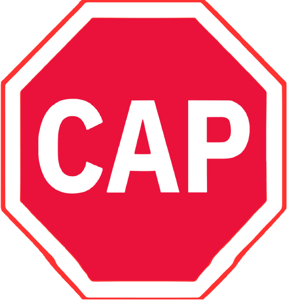
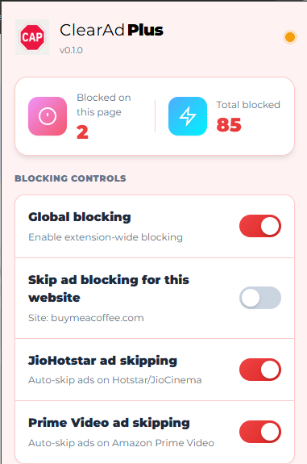

#  Clear Ad Plus

[](https://chrome.google.com/webstore)
[](https://github.com/hrishi025/ClearAdPlus/releases)
[](LICENSE)
[](https://github.com/hrishi025/ClearAdPlus/pulls)
[](https://github.com/hrishi025/ClearAdPlus/stargazers)
[](https://github.com/hrishi025/ClearAdPlus/network/members)

> A powerful, lightweight, and privacy-focused ad blocker for Chrome with support for YouTube, JioHotstar, and Amazon Prime Video.

## 🎯 Supported Platforms

<div align="center">
  
  
  
</div>

<div align="center">
  <sub>Currently supported • More platforms coming soon</sub>
</div>

## ⭐ Star us on GitHub — it helps!

[](https://github.com/hrishi025/ClearAdPlus)

## ☕ Buy me a coffee

If you find this project helpful, consider buying me a coffee to support continued development.

[](https://buymeacoffee.com/hrishi025)

## ✨ Features

### 🛡️ Core Ad Blocking
- **Network-Level Blocking**: Uses Chrome's Declarative Net Request API for efficient blocking
- **Cosmetic Filtering**: Hides banner ads and sponsored content
- **Filter Lists**: Supports EasyList and custom subscription URLs
- **Automatic Updates**: Filter lists update every 24 hours

### 🎯 Platform-Specific Ad Skipping
- **YouTube**: Auto-skips video ads with smart detection
- **JioHotstar/JioCinema**: 16x speed fast-forward, auto-mute, skip button auto-click
- **Amazon Prime Video**: 8x speed fast-forward, auto-mute, skip button auto-click

### 🎨 Modern UI
- **Clean Design**: Professional red-themed interface with Montserrat typography
- **Platform Logos**: Visual branding for YouTube, Hotstar, and Prime Video
- **Statistics**: Real-time blocked request counts with animated counters
- **Badge**: Shows blocked count on toolbar icon
- **Toggle Controls**: Enable/disable features per platform
- **Dynamic Refresh**: Instant refresh buttons appear when settings change
- **Supported Platforms Section**: Shows all supported streaming platforms
- **Social Links**: GitHub star, Buy me a coffee, and feedback buttons

### 🔒 Privacy & Performance
- **Zero Telemetry**: No data collection or analytics
- **Local Storage**: All data stored locally in Chrome
- **Minimal Overhead**: Optimized for performance
- **Manifest V3**: Compliant with Chrome's latest extension standards

## 📸 Screenshots

### Popup Interface


## 🚀 Installation

> ⚠️ **Important**: This extension is not yet published on the Chrome Web Store. To avoid Chrome's warning about non-Web Store extensions, please use the ZIP file installation method below.

### From GitHub ZIP (Recommended)
1. Go to the [GitHub repository](https://github.com/hrishi025/ClearAdPlus)
2. Click the green **Code** button and select **Download ZIP**
3. Extract the downloaded ZIP file
4. Open Chrome and navigate to `chrome://extensions/`
5. Enable **Developer mode** (top-right toggle)
6. Click **Load unpacked** (top-left)
7. Select the extracted `clearblock` folder
8. The extension is now loaded!

### From Source (Developer Mode)
1. Clone this repository:
   ```bash
   git clone https://github.com/hrishi025/ClearAdPlus.git
   ```
2. Open Chrome and navigate to `chrome://extensions/`
3. Enable **Developer mode** (top-right toggle)
4. Click **Load unpacked** (top-left)
5. Select the `clearblock` directory
6. The extension is now loaded!

## 📖 Usage

### Basic Blocking
- **Global Toggle**: Enable/disable blocking globally from the popup
- **Per-Site Allowlist**: Skip ad blocking for specific websites
- **Statistics**: View blocked request counts in the popup

### Platform-Specific Features
- **YouTube**: Ads are automatically skipped (always enabled)
- **JioHotstar**: Toggle "JioHotstar ad skipping" in popup (default: enabled)
- **Prime Video**: Toggle "Prime Video ad skipping" in popup (default: enabled)
- **Platform Logos**: Visual indicators for supported platforms in popup

## 🛠️ Development

### Prerequisites
- Node.js 16+
- Chrome 127+ (for Manifest V3 support)

### Setup
```bash
# Install dependencies
npm install

# Run tests
npm test

# Build static ruleset (optional)
node tools/build-static-ruleset.mjs --input filters.txt --output rules/custom.json
```

### Project Structure
```
clearblock/
├── src/
│   ├── background/      # Service worker and DNR logic
│   ├── content/         # Content scripts for different platforms
│   ├── popup/           # Popup UI
│   └── shared/          # Shared utilities
├── icons/              # Extension icons
├── rules/              # DNR rules
├── test/               # Unit tests
├── tools/              # Build and utility scripts
├── docs/               # Documentation
└── manifest.json       # Extension manifest
```

## 🧪 Testing

### Manual Testing Checklist
- [ ] Extension loads without errors
- [ ] Popup opens correctly with proper logo
- [ ] Global blocking toggle works
- [ ] Per-site allowlist works
- [ ] YouTube ad skipping works
- [ ] JioHotstar ad skipping works
- [ ] Prime Video ad skipping works
- [ ] Platform logos display correctly
- [ ] Dynamic refresh buttons appear on toggle
- [ ] Statistics display correctly with animation
- [ ] Settings persist across browser restarts
- [ ] Social links work (GitHub, Buy me a coffee, Feedback)

### Automated Tests
```bash
npm test
```

## 🤝 Contributing

We welcome contributions! Please follow these guidelines:

1. **Fork the repository**
2. **Create a feature branch** (`git checkout -b feature/amazing-feature`)
3. **Commit your changes** (`git commit -m 'Add amazing feature'`)
4. **Push to the branch** (`git push origin feature/amazing-feature`)
5. **Open a Pull Request**

### Development Guidelines
- Follow the existing code style
- Add tests for new features
- Update documentation as needed
- Ensure all tests pass before submitting

## 📝 License

This project is licensed under the MIT License - see the [LICENSE](LICENSE) file for details.

## 🙏 Acknowledgments

- [Adblock Plus](https://adblockplus.org/) - For filter list format inspiration
- [kushwantheswar/jiohotstar-ad-blocker](https://github.com/kushwantheswar/jiohotstar-ad-blocker) - JioHotstar ad skipping algorithm
- [Chrome Extensions Documentation](https://developer.chrome.com/docs/extensions/mv3/) - Chrome API documentation

## 📮 Contact

- **Issues**: [GitHub Issues](https://github.com/hrishi025/ClearAdPlus/issues)
- **Discussions**: [GitHub Discussions](https://github.com/hrishi025/ClearAdPlus/discussions)

## 🔗 Links

- [Chrome Web Store](https://chrome.google.com/webstore)
- [Documentation](docs/)
- [Releases](https://github.com/hrishi025/ClearAdPlus/releases)
- [Wiki](https://github.com/hrishi025/ClearAdPlus/wiki)

---

<div align="center">
  <sub>Built with ❤️ by <a href="https://github.com/hrishi025">@hrishi025</a></sub>
</div>
